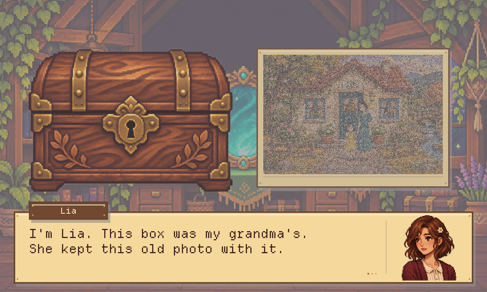
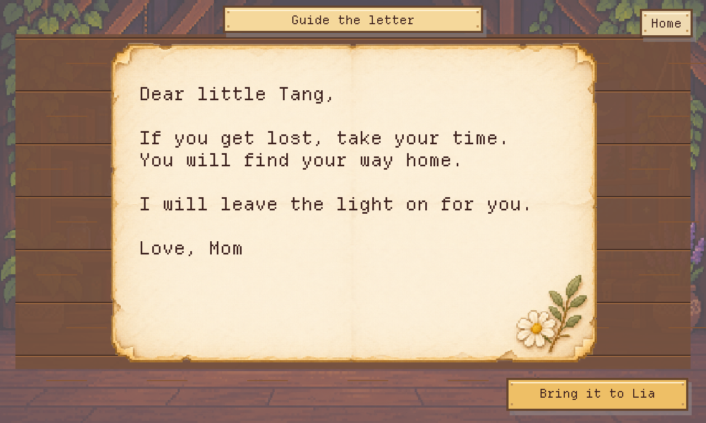
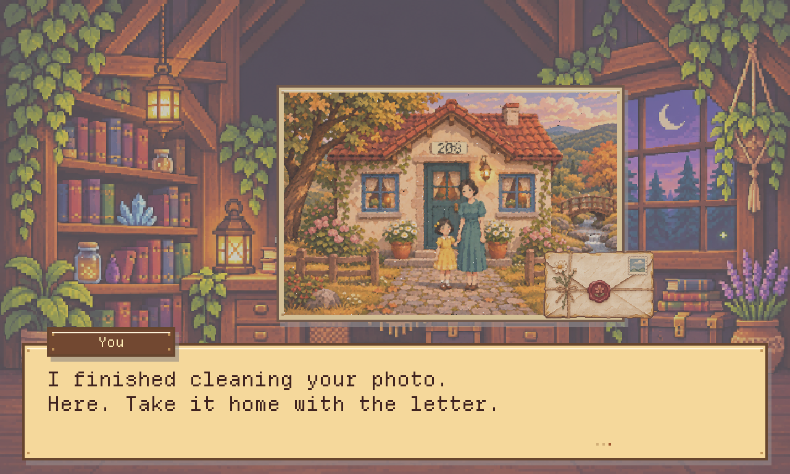

# Mirror Archive · 留灯

一个关于家与思念的像素交互故事。**openFrameworks 0.12.1 + OpenCV + MediaPipe**。

玩家创办了修复照片、信件与记忆的 **Mirror Archive**。门铃响起，Lia 带来已故奶奶的老照片和锁住的箱子。玩家和小猪助手 **tonton** 修复照片、手写密码，再用摄像头引导一封信穿过奶奶小时候的纸上迷宫。终点是一盏为家人留下的灯。故事最后，玩家安慰 Lia、归还修复的照片，再和 tonton 收好工具。


## 三关怎么玩

| 关卡 | 操作 | 实际计算 |
| --- | --- | --- |
| Restore the photo | 选择 Clean / Contrast / Detail，拖动画笔；调大小、Undo。看到门牌后点 I found the password! | 中值滤波、对比度展开、反锐化、三个局部掩膜 |
| Open the box | 每格手写一个数字，停笔后检查预测；Clear 重写，候选按钮纠正；Open 开箱 | 阈值、包围盒、图像矩校正、Sobel/HOG、OpenCV kNN |
| Guide the letter | Start camera；手掌先回中间，再移向一个方向，停留至环满。信封自动通过直路和单一弯道，在岔路、尽头、房屋停下 | OpenCV 摄像头／图像处理，MediaPipe 手部关键点、掌心平滑、方向分区、停留确认与回中重启 |

**第一关不要求涂满。** 玩家决定何时尝试密码；第二关点击 Photo 可回去继续修复，画笔结果和手写笔迹保留。第三关 Photo 可重看线索，走错可返回，也可 Start over。方向键和预览内箭头提供备用操作。

每关前 tonton 用简单英文说明玩法，过关后用开心表情推进故事。点击对话框或按空格继续。没有「?」提示按钮、倒计时或生命惩罚；ESC / Home 回封面。到家后 tonton 引导玩家点击折起的纸角，翻到留言；读完点击 Bring it to Lia，把照片和信带回 Lia 身边。信件全文使用一致的字体、字号与颜色。

封面包含雕花木质标题牌、浮尘、镜面微光与飞蛾动画；Meet us 查看人物，About 查看操作和素材声明，Sound on/off 控制门铃。



| 修复照片 | 手写开锁 |
| --- | --- |
|  |  |


| 折角翻信 | 把照片还给 Lia |
| --- | --- |
|  |  |

## 构建运行（macOS）

需要 Xcode 命令行工具、现有 openFrameworks 0.12.1 macOS 环境；摄像头功能另需 Python 3.11+ 和本地依赖。

```bash
./scripts/configure.sh /absolute/path/to/of_v0.12.1_osx_release
./scripts/setup-camera.sh
./scripts/build.sh
open build/Build/Products/Release/MirrorArchive.app
```

`setup-camera.sh` 将固定版本的 MediaPipe、OpenCV Python 包安装到项目 `.venv`，并检查随源码附带的官方手部模型。C++ 图像处理使用 OF 的 `ofxOpenCv`，手部识别进程通过本机管道传递掌心坐标和预览。没有新增 addon，也不需要实体道具。移动 app 到项目之外时，可用 `MIRROR_PYTHON` 指定包含这些依赖的 Python 解释器。

摄像头仅在点击 Start camera 后开启；首次使用需要 macOS 授权。画面只在本机内存显示，不保存、不上传。Camera off、回主页、到达终点和退出均关闭追踪进程。游戏运行不需要网络。

## 验证

```bash
./tests/run_tests.sh
python3 tests/test_hand.py
build/Build/Products/Release/MirrorArchive.app/Contents/MacOS/MirrorArchive --qa
# 等待摄像头启动，再检查 5 秒收帧／预览／关闭，不保存摄像头画面
build/Build/Products/Release/MirrorArchive.app/Contents/MacOS/MirrorArchive --qa-camera
```

2026-11-22 算法验证：**85 项旧回归 + 583 项故事检查 + 6 项 Python 测试通过**。数字独立留出集 **2369 / 2500（94.76%）**；鼠标笔迹 208 与九种上下两圈的 8（不同粗细、±12° 倾斜）通过。留出样本不参与训练或增强；这些结果不代表所有人的笔迹都能正确识别。

本机原生摄像头验证收到 **35 帧预览**，启动约 3.1 秒，关闭成功，完整故事 QA 通过。

本次原生 QA 还验证了新增人物／说明面板、声音开关、门铃事件顺序、折角翻信、归还照片与离开后对话。原生 QA 通过真实鼠标输入画笔和密码、键盘走迷宫，覆盖完整故事、空密码拒绝、照片返回编辑、途中退出重开；截图位于 `build/Build/Products/qa`。摄像头连通性和掌心状态机分别验证，**不等同于多用户、不同光照下的真人体验验证**。

## 主要文件

- `src/ofApp.*`：故事状态、像素界面、输入、摄像头预览、自动试玩。
- `src/StoryScript.h`：简单英文台词、门铃／展示遗物／归还照片／离开的剧情事件。
- `src/HomewardGame.h`：滤镜画笔、HOG/kNN、掌心输入状态机、迷宫路径规则。
- `src/HandInput.h`、`bin/data/hand/tracker.py`：本地追踪进程和消息接口。
- `src/PixelUI.h`、`src/Tonton.h`：原创像素图形和小猪动画。
- `bin/data/art/`：场景、Lia 三表情、地图、建筑、开合箱子、信封、信纸和标题牌；`fonts/`：OFL 像素字体；`audio/`：原创合成门铃。
- `tests/`：算法、交互状态与笔迹回归。

早期 `ArchiveGame.h`、`LevelFactory.h`、`VisionEngine.h`、光流与捏合模块保留作旧版本回归；当前第三关采用掌心位置，不能把它写成光流方案。

[技术与课程对应](docs/TECHNICAL.md) · [演示路线（剧透）](docs/DEMO.md) · [素材来源与生成提示词](docs/ASSETS.md)

课程 PDF 报告和在线演示视频仍需另外整理提交。
