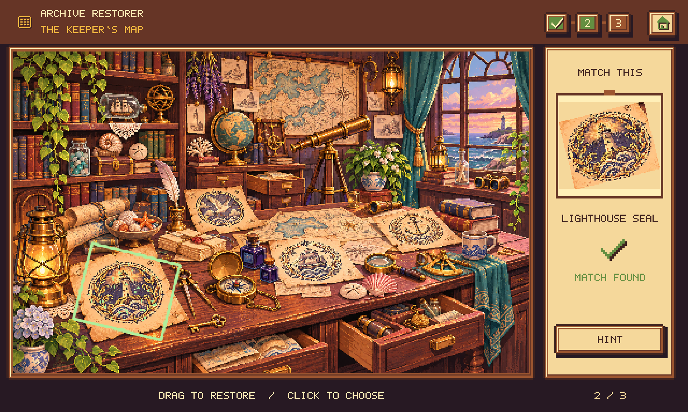

# Mirror Archive · 魔镜档案

**Restore the keeper's last light.** An offline hidden-object story built with **openFrameworks 0.12.1 + OpenCV**.

你是一名档案修复员。一场风暴损坏了灯塔守望者留下的记录：从库房照片里找回钥匙，进入他的地图室，再修复最后一卷温室影像。三关连续推进，无需摄像头、实体道具或网络。


## 一种操作，三个章节

首页点击 **START**。**拖动修复，单击选择右侧的目标**。选对后自动推进故事；选错可以继续寻找。HINT 会圈出大致区域，第三关可用 PAUSE 冻结画面。

| 章节 | 场景与目标 | 自动使用的算法 |
| --- | --- | --- |
| 01 · The lost key | 在受损的档案库照片中找青绿色钥匙；玻璃瓶和普通钥匙是干扰物 | 中值去噪、强度调整、HSV 分割、形态学开闭运算、Canny |
| 02 · The keeper's map | 在凌乱的地图桌上找到与档案残片相符的灯塔印章 | SIFT、L2 近邻比值筛选、RANSAC 单应性；显示真实匹配 |
| 03 · The last film | 在夜间温室影像中找到向左飞的飞蛾 | 帧差、阈值化、形态学、Farneback 光流；用实测方向验证选择 |

没有工具切换、能量、证据收集或提交模式。拖动不会意外提交答案。按 Enter 开始，Esc 返回首页，第三关 Space 暂停/继续。



所有处理结果来自**观测像素**。第一关的画笔显示去噪和分割结果，不是贴回原图；第二关的选择必须通过特征与几何验证；第三关的方向来自相邻帧的光流，而非预设轨迹。故事场景由 imagegen 原创生成，动态飞蛾由运行时合成后再进行视觉测量。

## 构建和运行

目前支持 macOS；在 Apple Silicon、Xcode 27.2、OF 0.12.1 环境验证。不需要额外 addon。使用发行包自带的 OpenCV。

```bash
./scripts/configure.sh /absolute/path/to/of_v0.12.1_osx_release
./tests/run_tests.sh
./scripts/build.sh
open build/Build/Products/Release/MirrorArchive.app
```

当前课程工作区可直接运行 build 脚本，它会找到 `../../of_v0.12.1_osx_release`。也可 configure 后打开 `MirrorArchive.xcodeproj`，选择 **MirrorArchive Release → My Mac** 并按 ⌘R。

界面是原创 5×7 位图字、640×384 画布、整数倍最近邻缩放，支持 Retina。英文游戏界面、中文项目说明。没有运行时网络请求或用户数据采集；当前版本无需存档，START 每次从第一章开始。

## 文件结构

| 文件 | 职责 |
| --- | --- |
| `src/ofApp.*` | 像素界面、拖动/点击、自动转场、完整故事 QA |
| `src/LevelFactory.h` | 加载像素场景、损坏观测图、合成影像、评分标注 |
| `src/VisionEngine.h` | 不接收答案的实际图像处理 |
| `src/GameModel.h` | 单击/拖动分离、线性故事状态、探索掩膜 |
| `src/PixelUI.h` / `PixelGrid.h` | 位图字体、木框控件、像素缩放与输入映射 |
| `tests/VisionTests.cpp` | 对真实素材运行算法及规则回归检查 |
| `bin/data/art/` | 原创场景和透明飞蛾素材 |

## 验证

```bash
./tests/run_tests.sh
build/Build/Products/Release/MirrorArchive.app/Contents/MacOS/MirrorArchive --qa
```

51 项检查覆盖图像恢复、真实印章/干扰项、光流方向及静止帧、探索掩膜、点击/拖动边界、连续通关、Retina 坐标。原生 QA 通过同一套鼠标事件从 START 顺序完成三关；截图位于 `build/Build/Products/qa/`。

[技术与创意说明](docs/TECHNICAL.md) · [演示路线（含剧透）](docs/DEMO.md) · [素材来源与完整生成提示词](docs/ASSETS.md)

课程要求的 PDF 报告与在线演示视频仍需整理、录制并提交；源代码仓库不能代替视频链接。
