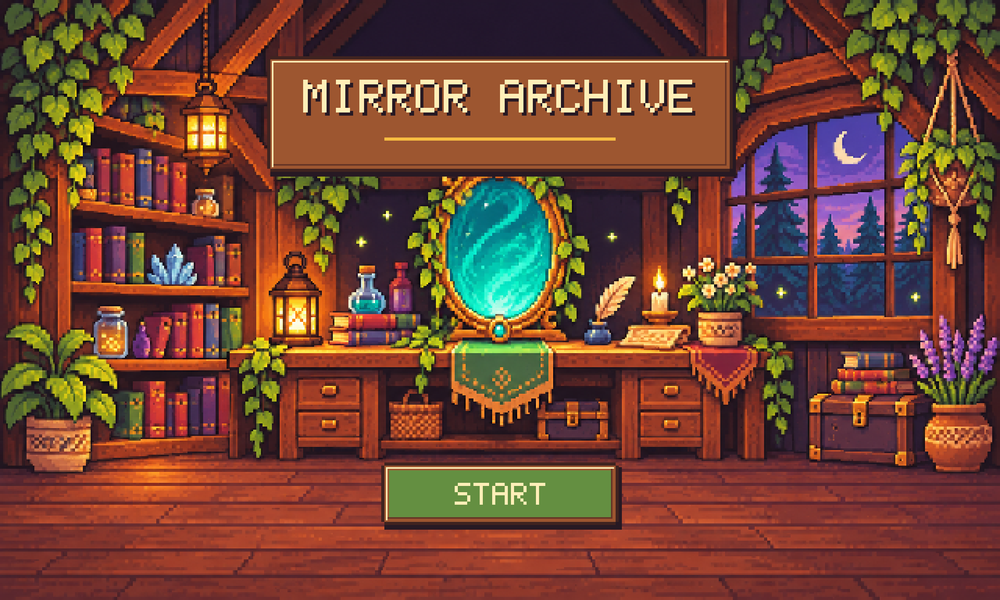
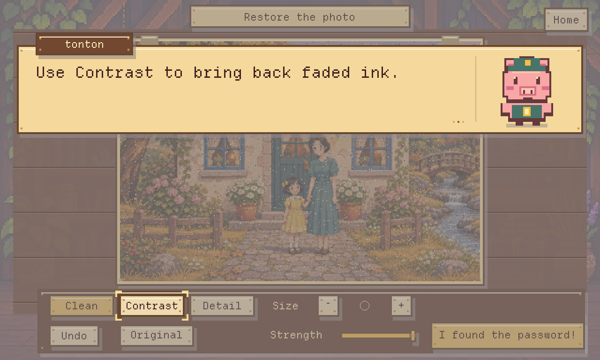
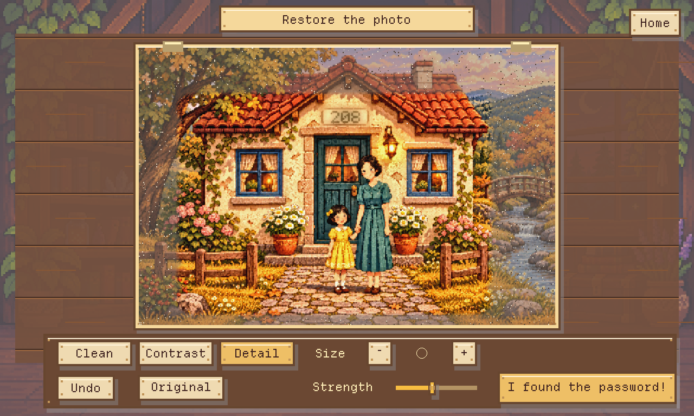
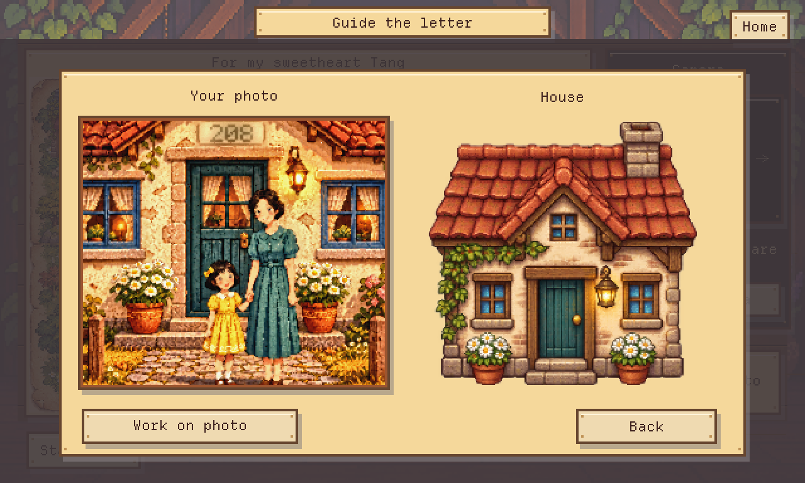
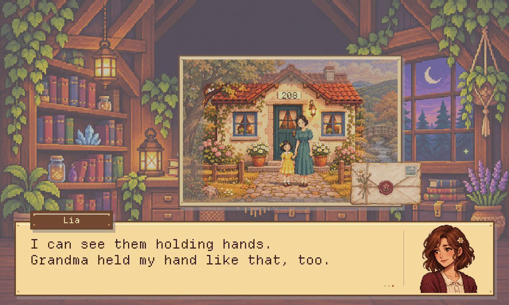

# Mirror Archive · A Light Left On

A small pixel-art story made for the **CityUHK CS4187 Mini Project**.

You run Mirror Archive, a place that repairs old photos and keepsakes. Your helper is a little pig named **tonton**. One evening, Lia brings her late grandma Tang's photo and a locked box. Help her find the memory inside.

Built with **openFrameworks, OpenCV, and MediaPipe**. No physical props are needed.



## Play the story

| Chapter | What you do |
| --- | --- |
| Restore the photo | Paint with Clean, Contrast, and Detail. Change Size and Strength in the tool tray. Hold Original to compare. Find the house number. |
| Open the box | Write the password with your mouse. Check the numbers the game reads. Use Clear or choose another suggested number if needed. |
| Guide the letter | Compare the repaired photo with the houses. Use your camera and hand to guide the letter home. |

The house number has a small, faded stain. Clean and Contrast bring out the faint ink; the rest of the photo keeps its light aging.

You do not need to paint the whole photo. Click **I found the password!** when you are ready.

Click **Photo** in the second or third chapter to keep working on it. Your writing, route, and position stay saved during the story. **Back to the map** returns to the same place. When the letter is stopped, click any house on the map to see it next to your own repaired photo. This comparison window does not open by itself.

For the camera, hold your hand in the middle first. Move it to one side and wait for the ring to fill. The letter follows a straight path and stops at a fork, corner, house, or dead end. It never turns by itself. Bring your hand back to the middle before choosing another direction. Arrow keys and the arrows in the preview also work.

The box holds a sealed envelope. Click **Open envelope** to find the map inside. The map says **For my sweetheart Tang**. Finish it before turning it over to read **My dear Tang,** and the message on the back.

tonton explains one thing at a time, in one or two short sentences. The photo guide highlights each tool before explaining it. Celebrations have their own dialogue box, followed by the next task and a friendly invitation to start. Painting, changing tools, writing, and reaching a corner do not open extra dialogue. Camera instructions appear only on the first start. A wrong password or house can bring a short reminder.

At the end, Lia receives **the photo you actually repaired**. If you bring the people in the photo back into view, she shares a memory of holding her grandma's hand. The game does not finish the photo for you.

Choose **Keep a copy** on the last screen to save your own photo as a PNG. Pick a folder in the save window. This saves the repaired image, without the game interface.




| Repair the photo | Write the password |
| --- | --- |
|  |  |






## Controls

- **Mouse:** paint, write, use buttons, and look at houses.
- **Hold Original / Space while repairing:** see the damaged photo. Release to return to your work.
- **Click a dialogue box / Space:** next line.
- **Esc / Home:** return to the cover. Starting again begins a new story.
- **Meet us / About:** meet the characters and read the project information.
- **Speaker icon:** turn the doorbell sound on or off.

## Build and run on macOS

You need Xcode command-line tools and openFrameworks **0.12.1**. The camera also needs Python **3.11+** and the local packages below.

```bash
./scripts/configure.sh /absolute/path/to/of_v0.12.1_osx_release
./scripts/setup-camera.sh
./scripts/build.sh
open build/Build/Products/Release/MirrorArchive.app
```

The camera setup script installs fixed package versions in `.venv`. The hand model is included. No extra addon is needed beyond `ofxOpenCv` from openFrameworks. If you move the app outside this project, set `MIRROR_PYTHON` to a Python interpreter with the required packages.

The camera starts only after you choose **Start camera**. macOS may ask for permission. Video stays on your computer: it is not saved or uploaded. Returning to the photo turns the camera off; returning to the map starts it again if it was on before. Home, the end of the maze, and quitting also turn it off. The game works offline after setup.

## How it works

- **Photo:** selective median filtering, contrast based on the photo's brightness histogram, weak-detail enhancement, and local luminance equalization (CLAHE), gentle sharpening, and soft brush edges. Each tool has its own strength. Undo restores both painting and strength changes.
- **Writing:** thresholding, size and slant correction, HOG features, and OpenCV kNN.
- **Hand control:** OpenCV camera capture and MediaPipe hand landmarks, with smoothing, a hold timer, and a return-to-middle rule.

MediaPipe is an extension used for hand input. The current game does not use optical flow for control.

## Checks

```bash
./tests/run_tests.sh
python3 tests/test_hand.py
build/Build/Products/Release/MirrorArchive.app/Contents/MacOS/MirrorArchive --qa
# Also check the real camera. Camera frames are never saved in QA screenshots.
build/Build/Products/Release/MirrorArchive.app/Contents/MacOS/MirrorArchive --qa-camera
```

Current algorithm checks: **85 legacy checks, 1000 story checks, and 6 Python tests passed**. The digit reader scored **2369 / 2500 (94.76%)** on held-out samples. It also passed the mouse-written password and nine two-loop versions of 8. These results do not guarantee every person's handwriting will be read correctly.

The latest real-camera check received 41 frames on first start and 16 after returning from photo editing. Both sessions closed successfully; no camera images were saved.

Full-story QA covers painting, strength changes, Original, the sealed envelope and map reveal, handwriting, house views, returning to the photo, maze movement, returning the player's own photo, and saving an identical PNG. Automated maze play uses arrow keys. Real hand play under different lighting still needs user testing.

## Project files

- `src/ofApp.*`: screens, drawing, input, and story flow.
- `src/StoryScript.h`: simple English dialogue and story events.
- `src/HomewardGame.h`: photo tools, digit reading, hand input rules, and maze paths.
- `src/HandInput.h`, `bin/data/hand/tracker.py`: the local camera process.
- `bin/data/`: artwork, font, sound, digit samples, and the hand model.
- `tests/`: algorithm and interaction checks. Older modules remain for regression checks.

[Technical notes](docs/TECHNICAL.md) · [Demo guide — spoilers](docs/DEMO.md) · [Art sources and prompts](docs/ASSETS.md)

The course PDF report and online demo video must be prepared separately.
