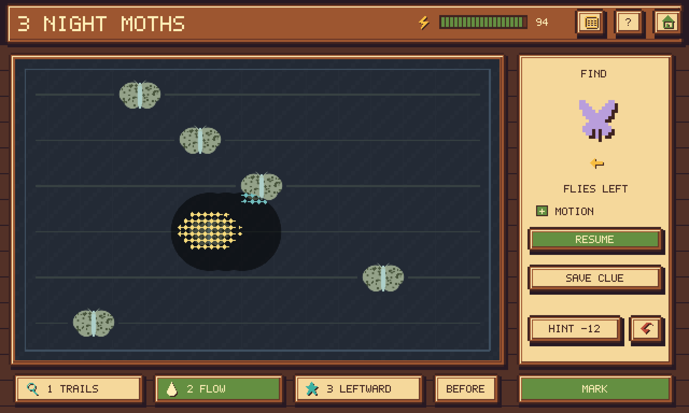

# Mirror Archive · A Light Left On

**An old photo. A locked box. A story waiting to be found.**


Welcome to Mirror Archive, your little workshop for old photos and forgotten memories. With tonton, your cheerful pig assistant, you help people care for the things they cannot replace.

One evening, Lia arrives with a faded photo and a locked box left by her grandmother. She misses her and hopes to find something inside that brings them closer again.

Take a seat at your desk. Look a little closer. Where will the first clue lead?

## Three chapters, one mystery

### Restore the photo

Brush away dust, bring back faded details, and look for a hidden clue. Choose your tools and brush size, adjust their strength, and compare your work with the old photo. You decide when it is ready.

### Open the box

Put your discovery to the test. Write the password with your mouse and try the lock. What has Lia's grandmother kept all this time?

### Guide the letter

Explore an illustrated map and look to your restored photo for clues. Use your webcam and hand to guide a little letter through the paths, one direction at a time.



## A little care goes a long way

- A warm pixel-art world, gentle animation, and a story about family and memory.
- tonton by your side, with short tips and a happy cheer when you succeed.
- Your own restored photo stays with you throughout the story. Save a copy to keep.
- Mouse painting, handwritten input, and camera controls. Arrow keys also work on the map.

Your camera stays on your computer. Video is never saved or uploaded.

<details>
<summary><strong>Build and play on macOS</strong></summary>

You need Xcode command-line tools, openFrameworks **0.12.1**, and Python **3.11+** for camera controls.

```bash
./scripts/configure.sh /absolute/path/to/of_v0.12.1_osx_release
./scripts/setup-camera.sh
./scripts/build.sh
open build/Build/Products/Release/MirrorArchive.app
```

Keep the app inside the project folder. Choose **Start camera** in the map chapter and allow camera access when asked. The game works offline after setup.

Click dialogue boxes or press **Space** to continue. **Esc** closes the photo view or returns to the cover. Starting again begins a new story.

</details>

---

Made for the **CityUHK CS4187 Mini Project**, with openFrameworks, OpenCV, and MediaPipe.

[Project report](report/MiniProject_Report.pdf) · [Technical notes](docs/TECHNICAL.md) · [Credits](docs/ASSETS.md)
