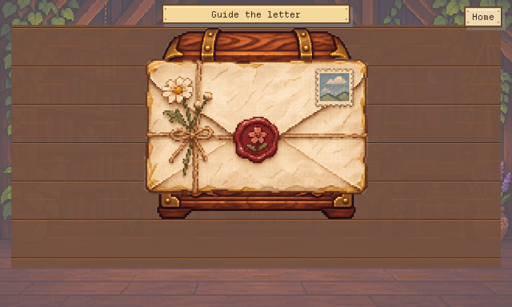
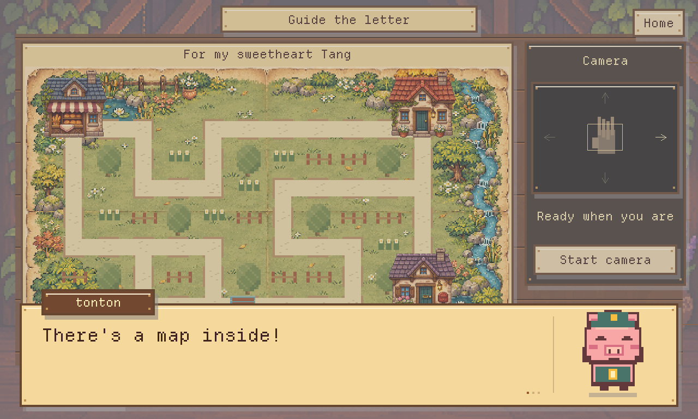

# 留灯演示路线（剧透）

1. Start。以“我”的视角介绍自己创办的 Mirror Archive 和助手 tonton。门铃响起后欢迎 Lia；她带来奶奶留下的照片和箱子。点击对话框／空格继续；介绍遗物时镜头推近，tonton 随后说明画笔。
2. Clean 刷掉门牌附近噪点，Contrast 加强褪色文字，再试 Detail。用 + / - 改大小，Strength 调整当前工具强度，Undo 撤销。按住 Original 或空格 看受损原貌，松开恢复自己的修复。门牌是 **208**。无需涂满，点 **I found the password!**。
3. 按引导在三格手写 **2 / 0 / 8**。8 可以画连续交叉圈，也可以画上下两圈。停笔后看小窗口；必要时选候选或 Clear 重写。Photo 返回第一关继续修复，Back to the box 返回箱子。Open，tonton 会为开锁成功欢呼。
4. 开箱时只看到信封。点击 **Open envelope** 或信封本身，再发现里面的地图和「For little Tang」。此时不透露地图作者或背面的留言。
5. **Start camera**。手掌放预览中间，移向方向区域并停到环满；回中间后再选下一方向。无需快速挥手或捏合。信封沿选定方向通过直路，到岔口、弯角、房屋或尽头就停。转弯需要新的方向输入。
6. 一条短路线：**右、右、右、上、左、上、右、上**。依次到 (3,7)、(5,7)、(9,7)、(9,5)、(7,5)、(7,3)、(11,3)、(11,1)。先观察岔路和房子；蓝顶面包店、紫顶邮局不是老家。点击房屋看近景，与玩家修复后的照片并排比较。Photo 可返回继续修复，Back to the map 回到原来的位置；tonton 不直接透露目标特征。走错可原路返回。
7. 到家，tonton 先开心庆祝、发现地图背面的字，再提示点击折角。点击右下折角翻纸，读「I will leave the light on for you. Love, Mom」。
8. 点击 **Bring it to Lia**。Lia 想起奶奶也总为她留灯。“我”安慰她、亲手归还玩家实际修复的照片；没有自动补修或额外提问。Lia 道谢离开后，“我”和 tonton 谈起今天的委托；人物区域有可见修复时，Lia 会说奶奶也曾这样牵她的手。最后 Keep a copy 选择位置导出自己的 PNG，Go home 回封面。
9. 可补充展示封面的 Meet us / About，以及右下角的小喇叭声音开关；背景有微光和浮尘，START 轻轻上下浮动。

算法解释放报告，游戏内保持短句。视频建议包含一次滤镜对比、一次多笔写 8，以及真实手掌回中→选方向→停留确认的画面。自动 QA 走迷宫用的是方向键，不能把截图或自动通关说成真人手势测试。摄像头画面录制用于提交视频前由玩家自行决定。

