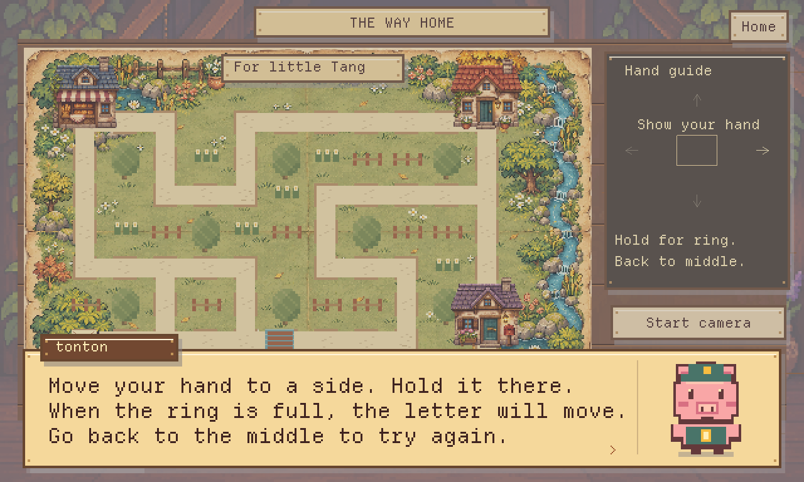

# 留灯演示路线（剧透）

1. Start。Lia 走进工作室，带来奶奶留下的照片和箱子。点对话框／空格读完短序章；tonton 说明画笔。
2. Clean 刷掉门牌附近噪点，Contrast 加强褪色文字，再试 Detail。用 + / - 改大小，Undo 撤销。门牌是 **208**。无需涂满，点 **I found the code**。
3. 按引导在三格手写 **2 / 0 / 8**。8 可以画连续交叉圈，也可以画上下两圈。停笔后看小窗口；必要时选候选或 Clear 重写。Photo 返回第一关继续修复，Back to the box 返回箱子。Open。
4. tonton 发现箱里的纸：「For little Tang」，这是奶奶的妈妈画给她的回家游戏。
5. **Start camera**。手掌放预览中间，移向方向区域并停到环满；回中间后再选下一方向。无需快速挥手或捏合。信封自动过直路和单一弯道。
6. 一条短路线：**右、右、右、上**。依次到 (3,7)、(5,7)、(11,3)、(11,1)。先观察岔路和房子；蓝顶面包店、紫顶邮局不是老家。Photo 可重看红屋顶、灯与花盆线索，走错可原路返回。
7. 到家，tonton 庆祝；**Turn the page** 翻纸，读「I will leave the light on for you. Love, Mom」。
8. Lia 想起奶奶也总为她留灯。返回封面可重新开始。

算法解释放报告，游戏内保持短句。视频建议包含一次滤镜对比、一次多笔写 8，以及真实手掌回中→选方向→停留确认的画面。自动 QA 走迷宫用的是方向键，不能把截图或自动通关说成真人手势测试。摄像头画面录制用于提交视频前由玩家自行决定。

