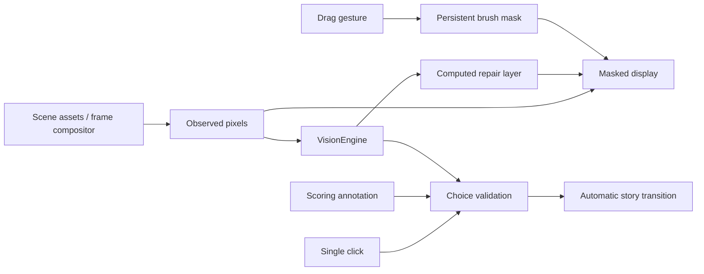

# 技术设计与创意说明

## 把修复工作变成一条故事

玩家是档案修复员，目标是找回灯塔守望者在风暴中遗失的记录。三个章节具有明确因果关系：库房照片中的钥匙打开书房；书房地图指向温室的旧影像；影像中的逆行飞蛾帮助定位需要修复的片段，最终留下灯塔最后的光。

图像处理服务于不同观察问题：颜色与形状、局部纹理、时间方向。算法由章节自动选择；玩家不必在工具、证据和提交按钮之间切换。这是面向演示与初次玩家的交互简化，并没有用预存结果替代计算。

- 库房中的青绿色瓶子会产生颜色响应，但不是钥匙；另一把普通钥匙符合形状，却没有目标颜色。去噪让细节可见，颜色与边缘强调可能的线索。
- 桌面上有鸟、船、锚、灯塔等海事印章。参考残片经过旋转缩放，匹配必须满足局部纹理和几何一致性。
- 温室中六只飞蛾共享同一张透明精灵，静态外观不能识别目标；方向来自两个连续画面。玩家可以冻结最后测得的运动，轻松点击。

故事是三个固定的短谜题，HINT 提供宽泛区域提示。没有倒计时、能量扣除或强制证据步骤。趣味来自场景寻找和修复前后的信息变化，未声称经过用户研究证明其可玩性。

## 数据流

`VisionEngine` 不接收关卡编号、答案位置、精灵索引或预设轨迹。评分标注仅供第一/三关命中判定和可选提示。第二关实际用匹配得到的投影四边形包含点击点来判定；第三关还必须测到足够一致的左向光流。

## 图像处理

### 01：去噪、颜色和边缘

场景按最近邻采样成 480×300 像素，再放大到 960×600 供 OpenCV 使用。原始素材只供观测图制作及目标参考，不会被传给修复镜片。

1. 模拟损坏：`D = 0.37 * I + 65`，加入固定种子的 30,000 个盐椒采样点。
2. 中值滤波 k=3，随后 `2.7D - 175` 调整强度。这个近似逆变换不能恢复全部丢失细节。
3. HSV 范围 H∈[72,103]、S≥55、V≥30 筛选青绿色；3×3 椭圆核执行开、闭运算。
4. Canny(45,100) 提取去噪图的边缘，仅将颜色候选附近的边缘叠加在修复画面上。2×2 膨胀帮助半尺寸显示保留细线。
5. 一次拖动同时看到清晰的场景和淡绿色线索轮廓，无需切换三个按钮。

测试中，恢复结果相对原始场景的 L1 总误差由约 6.42×10⁷ 降至 1.21×10⁷。原始图仅用于离线测试误差，不参与镜片计算。测试还确认钥匙和其它青绿色物体都会产生响应。

### 02：SIFT 识别地图

1. 从原场景中截取灯塔印章，旋转 14°、缩放 1.08 倍，作为独立朝向的档案残片。
2. 玩家拖动时查看真实 SIFT 关键点，并每 0.4 秒自动匹配一次；释放鼠标后再检查当前位置。单击选择也会重新验证。
3. 查询图和局部 300×280 观测区域分别提取 SIFT 特征，L2 BFMatcher 取两个近邻。
4. `d1 < 0.72*d2` 筛选候选，至少 6 个候选才能估计 RANSAC 单应性，重投影阈值 3 像素。
5. 需要至少 8 个内点、内点比例≥45%、投影四边形有限且凸、面积合理。
6. 从真实内点中等间隔显示最多 32 个标记，并显示投影边框，避免遮挡印章。只有点击在验证通过的投影四边形内才算完成；扫描范围碰到目标但点击在另一物体上不会通过。

当前素材的回归测试得到 128 个比值筛选匹配、128 个内点；鸟、船、锚和背景区域均未通过。实际计数可能随 OpenCV 构建和扫描位置变化。

### 03：从影像测量方向

1. 原创透明飞蛾精灵以 alpha 混合叠加在温室背景上。六只外观相同，位置分散，运动包含轻微竖直变化；不再绘制横向轨道。
2. 每个模拟帧水平移动约 2 个观测像素。帧率改变只影响播放速度，不改变相邻帧的位移。
3. 相邻原始帧先做灰度绝对差、阈值 9、3×3 闭运算、5×5 膨胀，确定运动区域。
4. Farneback 参数：pyr_scale=.5、levels=3、winsize=19、iterations=3、poly_n=5、poly_sigma=1.2。
5. 对帧差区域做 19×13 闭运算并分析连通域。每个区域汇总长度>.65 的实际光流，在物体上方绘制一个清晰箭头；箭头两端为中心±9倍实测平均速度。金色指向左，蓝绿色指向右。分组只读取图像和流场，不读取精灵位置。
6. 单击时检查附近 36×28 区域：有效运动样本>40，且其中向左样本超过 65%。还要命中目标飞蛾，避免选择背景。
7. PAUSE 保留最后一对帧的流场。两个完全相同的输入帧直接返回零流，避免密集像素纹理上的数值漂移。

回归测试中，五只飞蛾的平均水平光流约 +1.83 至 +1.99；逆行者约 -1.92。算法看到的是合成后像素，不是位置表。合成序列比真实视频更可控；遮挡、相机移动、回绕瞬间仍是方法的局限。回绕时若没有可靠方向证据，不会仅凭坐标判为完成。

## 统一的交互

`display = (1 - M/255) * observed + (M/255) * processed`

每关只有一个持久掩膜。拖动轨迹插值，每 20 个观测像素盖一个半径 82 的圆；探索不限次数。鼠标移动超过 4 个逻辑像素才认定拖动，整段手势一旦成为拖动，即使返回原点也不会误判为单击。

`Campaign` 只允许已完成的章节推进：0→1→2→结局。成功后用一句话衔接下一关，3.6 秒自动转场，没有额外确认或关卡菜单。START 总从第一章开始。

## 清晰度与验证

- 原创 5×7 位图字、640×384 FBO、整数倍缩放、GL_NEAREST、Retina 支持。
- 场景与 UI 都落在同一逻辑像素网格，鼠标使用相同的整数缩放和留边变换。
- 51 项 C++ 检查直接运行 OpenCV 和游戏规则，包含真/假匹配、静止/运动、鼠标抖动/拖动、不可跳关、重开与素材边界。
- 原生 `--qa` 使用与玩家相同的按下/拖动/释放事件，从 START 自动完成整个故事。不会直接跳进第二或第三章。
- 所有操作均离线；不需要摄像头或实体物品。缺失素材会明确报错，避免悄悄退回旧的简单图案。

## 报告可引用的资料

- [OpenCV：SIFT 与特征匹配](https://docs.opencv.org/4.x/dc/dc3/tutorial_py_matcher.html)
- [OpenCV：光流](https://docs.opencv.org/4.x/d4/dee/tutorial_optical_flow.html)
- [OpenCV：形态学](https://docs.opencv.org/4.x/d9/d61/tutorial_py_morphological_ops.html)
- 素材来源、生成方式和完整提示词见 [ASSETS.md](ASSETS.md)。

可在报告中补充固定 ROI 的恢复误差、SIFT 阈值对误匹配的影响，以及真实光流方向分布。尚未进行的用户测试不要写成已完成。
