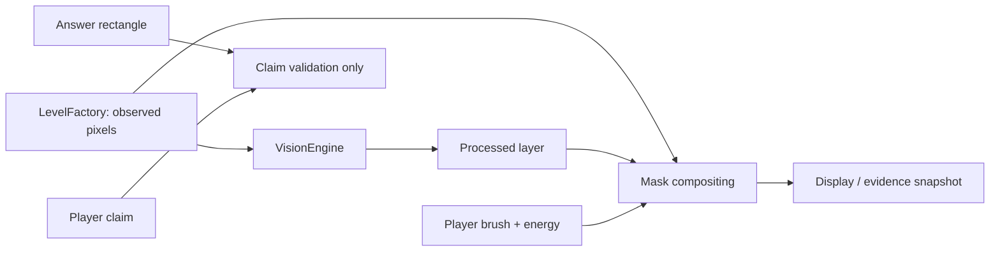

# 技术设计与创意说明

## 让算法成为推理规则

这不是给同一图片换三种滤镜。每关提出不同的视觉歧义，工具只能提供一部分证据。

- **颜色不是身份。** 第一关有多个青绿色徽章，也有多个七角徽章。颜色筛选缩小范围，边缘显示角数；玩家必须把两种证据结合起来。原始图的盐椒噪声会产生大量伪边缘，按 X 能直接比较中值滤波的作用。
- **轮廓相似不代表同一件物品。** 第二关所有版画都有相同的星形主体，细小刻痕不同。玩家购买局部 SIFT 验证；匹配数量和几何一致性共同决定证据是否可信。旋转和缩放使简单逐像素比较不合适。
- **外观完全相同，时间仍提供信息。** 第三关六只飞蛾使用相同的纹理，单帧外观不能区分身份。帧差显示哪里动，光流显示向哪动，方向过滤找出逆行者。冻结时间把瞬时现象变成可检查的证据。

能量为信息选择引入代价；玩家可以用大画笔快速扫视，也可精准探查并争取高评级。证据笔记本保留自己的观察过程。玩家提交的是有依据的结论，而不是随便点中某个坐标。

## 数据流与职责

`VisionEngine` 的函数接收 `cv::Mat` 与扫描区域，不接收关卡 ID、答案坐标或运动轨迹。`LevelFactory` 同时负责场景生成和点击判定数据；这不意味着算法能读到答案。`ofApp` 将两条数据流分开调用。

### 局部擦镜

设观测图为 D、当前算法结果为 T(D)、掩膜为 M/255：

`display = (1 - M/255) * D + (M/255) * T(D)`

每个工具保留独立掩膜。画笔使用抗锯齿圆形并沿拖动路径插值，新增掩膜值决定费用：

`cost = sum(max(oldMask, stamp) - oldMask) / (255 * imageArea) * layerCost`

余额不足时不修改掩膜，不允许负数成本或负数余额。工具切换不会清除已购买观察区域。比较原始图无需额外扣费。

### 第一关：去噪、颜色、形状

1. 使用固定随机种子生成有颜色和形状干扰项的徽章照片。
2. 降低动态范围并添加盐椒噪声，构成玩家可见的观测图。
3. Clean 使用 `medianBlur(k=5)`，随后线性强度窗口 `2.7I - 175`。这是已知曝光条件的近似调整，不声称恢复不可逆丢失的细节。
4. Color 对恢复结果转 HSV，筛选 H ∈ [77,103]、S ≥ 65、V ≥ 35，做 5×5 椭圆开运算及闭运算，再绘制轮廓。
5. Edges 使用 Canny(45,100)。X 切换是否预先去噪，分别保存两种探索掩膜。显示前对边缘做 2×2 膨胀，以保留半尺寸像素画布上的连续轮廓。

### 第二关：特征匹配与几何验证

1. 六张版画共享星形主体，但随机刻痕来自不同固定种子。真品与查询图共享纹理，经过旋转缩放后放入场景。
2. 仅对玩家点击的 260×260 观测区域提取 SIFT，描述子使用 L2 BFMatcher，k=2。
3. 用 `d1 < 0.72*d2` 过滤模糊匹配。
4. 至少 6 个候选才能估计 RANSAC 单应性，重投影阈值 3 像素。
5. 验证条件：内点 ≥ 8、内点比例 ≥ 45%、投影四边形有限且凸、面积合理。仅匹配数多不足以通过。
6. 叠加真实内点位置及投影边框，报告实际的候选数/内点数。

本机回归场景中真品得到 136 个 ratio matches / 120 个内点。仿品可能有 5–13 个内点，因为共享主体确实会匹配；几何比例等约束使它们没有被误认证。不同 OpenCV 构建可能产生略有差异的数量。

实现采用 [OpenCV 官方特征匹配说明](https://docs.opencv.org/4.x/dc/dc3/tutorial_py_matcher.html) 中的 SIFT/L2 与近邻比值思路。

### 第三关：从图像测量运动

1. 以固定纹理绘制连续观测帧，背景不变，飞蛾位移固定。每次推进一个模拟帧，避免渲染帧率改变真实位移。
2. UI、箭头和擦镜效果绘制前，先计算相邻原始帧的绝对差及 Farneback 光流。
3. 帧差阈值 9，3×3 闭运算。它能指示运动区域，但不能判断方向。
4. Farneback 参数：pyr_scale=.5、levels=3、winsize=19、iterations=3、poly_n=5、poly_sigma=1.2。
5. 每隔 12 像素采样矢量，忽略小于 .55 像素的位移。金色表示向左、青色表示向右；Leftward 额外保留 u < -.6 的矢量。
6. 冻结时保留最后一对帧的测量结果，避免对同一帧重复计算而把光流清零。

参照 [OpenCV 官方光流说明](https://docs.opencv.org/4.x/d4/dee/tutorial_optical_flow.html)。合成序列满足较稳定的亮度和纹理条件，便于课堂演示。它并不是在自然视频、遮挡、相机抖动条件下验证过的通用追踪器。飞蛾回绕到起点的瞬间可能出现不可靠光流，重新运动后恢复正常；不要使用回绕瞬间作为方向证据。

## 验证与局限

- C++ 测试直接运行 OpenCV，不用预存算法结果代替调用。
- 区分同构真品和五个相似仿品；测试空白纹理及越界 ROI。
- 真实流场的平均水平位移应为五只约 +2、一只约 -2；静止图对接近零。
- 掩膜全零/全满必须分别等于观测图/处理图；重复探索不收费，不能透支。
- 原生 QA 模式走过探索、证据、判定和三个结算状态；另进行截图人工检查。

关卡为精心设计的固定谜题，重玩主要优化探索路线，不随机改变答案；提示和演示文档会透露解法。窗口按统一逻辑坐标缩放。当前 Xcode 配置和存档路径针对 macOS；跨平台需调整用户数据目录并重新生成 OF 工程。

## 可用于报告的实验

1. 固定同一区域，对比 raw Canny 与 median → Canny，统计强边缘像素数并展示截图。
2. 将 SIFT 的 ratio 阈值改变为 0.6 / 0.72 / 0.85，比较真品内点率和仿品误匹配。保留正常游戏参数为 0.72。
3. 对比静止帧、向左/右位移帧，绘制实际 u 分量分布；讨论亮度恒定假设和回绕失效。
4. 请几位同学比较“直接显示全部结果”与“能量+局部镜片”，记录完成时长、错误次数及剩余能量。尚未进行的用户实验不要写成已完成。

## 像素界面与清晰度

- 开启 `NSHighResolutionCapable`，避免 macOS 把低分辨率窗口整体放大。
- 所有界面绘制到 640×384 FBO，再按 1×/2×/3×/4×等整数倍居中显示。最近邻采样保留像素边缘，剩余区域留边，不做非整数拉伸。
- 字体是原创 5×7 位图，每个字形直接由实色矩形组成，没有小字号 TrueType 纹理的放大插值。
- 输入坐标使用同一个缩放/留边变换。回归检查覆盖 Retina、普通屏及非整齐尺寸窗口。
- 主画面只显示任务目标、能量、工具和关键操作；完整快捷键收进 `?`，算法细节保留在文档。
- 关卡美术采用最近邻像素网格，算法仍在 900×560 观测像素上真实计算。
